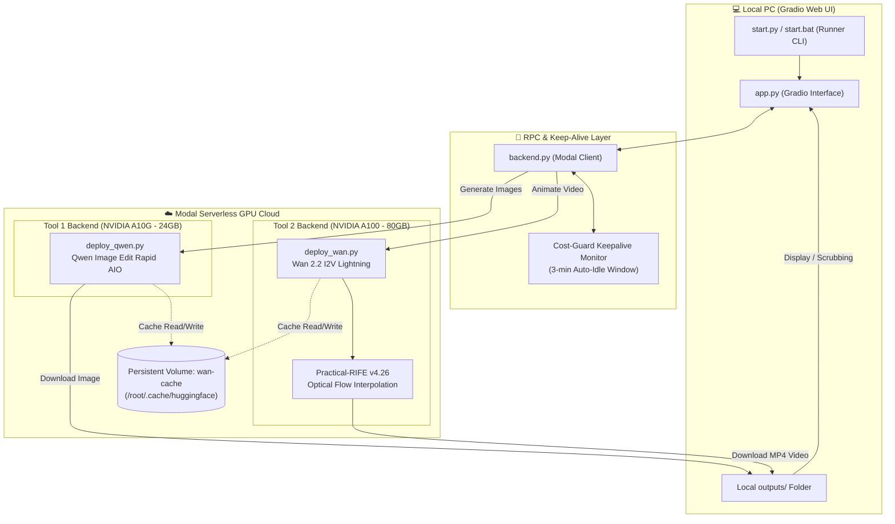

# 🎬 Wan 2.2 Studio · Generative AI Creative Suite

<div align="center">

[](https://python.org)
[](https://gradio.app)
[](https://modal.com)
[](https://pytorch.org)
[](https://github.com/huggingface/diffusers)
[](LICENSE)

**A high-performance generative AI video and image production suite combining Qwen Image Edit Rapid AIO with Wan 2.2 Image-to-Video Lightning, powered by serverless NVIDIA GPUs on Modal.**

[Features](#-key-features) • [Architecture](#-architecture--workflow) • [Quick Start](#-quick-start) • [Installation](#-installation--setup) • [Configuration](#-parameter-guide) • [Testing](#-testing--verification)

</div>

---

## 🌟 Overview

**Wan 2.2 Studio** is an integrated pair-generation environment designed for high-fidelity image editing and cinematic video synthesis. It bridges local interactive control with serverless cloud compute:

1. **Tool 1: Qwen Image Edit Rapid AIO** (running on NVIDIA A10G GPU) — Rapid text-to-image synthesis, conversational image editing, and multi-reference identity/style transfer.
2. **Tool 2: Wan 2.2 Image-to-Video Lightning** (running on NVIDIA A100-80GB GPU) — Diffusion motion synthesis powered by Flow Matching Lightning weights, paired with RIFE optical-flow frame interpolation for smooth video outputs up to 64+ FPS.

All model compute runs remotely on [Modal](https://modal.com) serverless containers with persistent weight caching, while the user interface runs locally with zero local VRAM requirements.

---

## 🏗️ Architecture & Workflow



### The 2-Step Creative Pipeline

```text
 📷 Text Prompt / Initial Image
            │
            ▼
 🖼️ Step 1: Qwen Image Edit Rapid AIO Studio (A10G GPU)
    ├── Text-to-Image generation or Image-to-Image editing
    ├── Dual reference image inputs (Reference 1 & 2 for character consistency)
    ├── True CFG scale & guidance scale separation
    └── Multi-image batching (1 to 6 images simultaneously)
            │
            ▼  [ 1-Click Route / Drag-and-Drop ]
 🎥 Step 2: Wan 2.2 Video Studio (A100-80GB GPU)
    ├── Diffusion motion synthesis from generated or edited frames
    ├── Optional dual-keyframe animation (First Frame + Last Frame)
    ├── 7 selectable diffusion schedulers (UniPC, FlowMatch, SASolver, etc.)
    └── RIFE optical flow frame interpolation (16, 32, 64, 128 FPS)
            │
            ▼
 🎬 Final Rendered MP4 Video (Auto-saved to ./outputs/)
    └── Interactive timestamp scrubber to extract keyframes back into Step 1 or Step 2
```

---

## 🚀 Key Features

### 🖼️ Tool 1 — Qwen Image Edit Rapid AIO
- **Conversational Image Editing**: Edit existing images using natural language prompts without losing character identity.
- **Reference Conditioning**: Provide up to two reference images for character transfer, facial preservation, or style injection.
- **True CFG Controls**: Independent sliders for True CFG Scale (`1.0`–`10.0`) and Guidance Scale (`0.0`–`5.0`) to suppress artifacts.
- **High-Resolution Support**: Custom resolution dimensions up to 2048×2048 px with multiple aspect ratio modes.
- **Multi-Image Batching**: Generate 1 to 6 candidates in parallel per inference call.

### 🎥 Tool 2 — Wan 2.2 Image-to-Video Lightning
- **A100-80GB Acceleration**: Executes dual 14B transformers on 80GB VRAM to handle large temporal latents without OOM.
- **Flow Matching Lightning**: Utilizes high-efficiency Flow Matching checkpoints (`WAMU_v2_WAN2.2_I2V_LIGHTNING`) for rapid sampling.
- **RIFE Neural Frame Interpolation**: Integrated Practical-RIFE v4.26 neural flow estimator providing 2×, 4×, and 8× temporal upsampling (16 FPS $\rightarrow$ 32, 64, or 128 FPS).
- **Multi-Scheduler Engine**: Switch between 7 distinct sampling algorithms including `UniPCMultistep`, `FlowMatchEulerDiscrete`, `SASolver`, and `DEISMultistep`.
- **First & Last Frame Guidance**: Define both beginning and terminal keyframes to steer complex motion trajectories.
- **Scrub & Extract**: Click on any frame in the generated video directly in the browser and send it straight back to Tool 1 or Tool 2 for iterative workflows.

### 🛡️ Smart Cost-Guard Keep-Alive System
- **Zero Passive GPU Billing**: Modal containers automatically spin down to 0 replicas when idle.
- **Heartbeat Protection**: Browser-based keep-warm pings only keep containers active when the web tab is open and has been used within the last 3 minutes (`KEEPALIVE_IDLE_WINDOW = 180s`).
- **Independent Keep-Warm Toggles**: Separately toggle Wan 2.2 and Qwen keep-alive states depending on your active workflow.

---

## 📂 Project Structure

```text
Wan-Studio/
├── app.py                      # Local Gradio 6 frontend & UI event dispatcher
├── backend.py                  # Local Modal RPC client & keep-alive manager
├── deploy_wan.py               # Modal serverless backend: Wan 2.2 I2V + RIFE (A100-80GB)
├── deploy_qwen.py              # Modal serverless backend: Qwen Image Edit (A10G)
├── start.py                    # Interactive CLI runner & environment manager
├── start.bat                   # 1-click Windows launcher
├── requirements.txt            # Python dependencies for local frontend
├── credentials.txt             # Optional Hugging Face token configuration
├── outputs/                    # Local storage for all generated images and MP4 videos
├── tests/                      # Automated test suite (27 tests)
│   ├── test_suite.py           # Core logic, aspect ratio, frame math & activity tests
│   ├── test_backend_contract.py# RPC signature verification & contract validations
│   └── test_e2e_pipeline.py    # End-to-end Picture -> Modify -> Animate mock workflow
└── test_bus.png                # Sample reference asset
```

---

## 🛠️ Installation & Setup

### 1. Prerequisites
- **Python**: 3.10, 3.11, 3.12, or 3.14 installed on your local machine.
- **Git**: Installed and available in your system `PATH`.
- **Modal Account**: Sign up at [modal.com](https://modal.com) (free monthly compute tier available).
- **Hugging Face Account**: A free account with a read-access token from [huggingface.co/settings/tokens](https://huggingface.co/settings/tokens).

### 2. Clone the Repository
```bash
git clone https://github.com/Bullseye25/Wan-Studio.git
cd Wan-Studio
```

### 3. Install Local Dependencies
Create a virtual environment (recommended) and install the lightweight local requirements:
```bash
python -m venv .venv
# Windows:
.venv\Scripts\activate
# Linux / macOS:
source .venv/bin/activate

pip install -r requirements.txt
```

> [!NOTE]
> Heavy AI packages (PyTorch with CUDA, Diffusers, Accelerate, Transformers, RIFE) run exclusively in Modal cloud containers and do **not** need to be installed on your local PC.

### 4. Authenticate Modal CLI
Set up your Modal account authentication:
```bash
python -m modal setup
```
*(This opens a browser window to link your Modal account token).*

### 5. Configure Hugging Face Token
Create a `credentials.txt` file in the root directory (or set the `HF_TOKEN` environment variable):
```text
HF_TOKEN=hf_YourHuggingFaceTokenHere
```

---

## 🚦 Quick Start

### Using the Windows Launcher
Double-click **`start.bat`** in the repository root.

### Using the Command Line
```bash
python start.py
```

The interactive runner menu will appear:

```text
============================================================
              Wan 2.2 Studio Localhost Runner               
============================================================
[Options]
1. Start Studio frontend locally
2. Deploy/Redeploy Wan 2.2 backend to Modal
3. Deploy/Redeploy Qwen Image Edit backend to Modal
4. Pre-cache Wan 2.2 model weights on Modal
5. Pre-cache Qwen Image Edit model weights on Modal
6. Start frontend on Local Network (mobile access)
7. Switch / Manage Modal Account Profiles (runs 'modal profile' / 'modal setup')
8. Clear local outputs folder (outputs/)

Enter choice [1-8] (default 1):
```

### Initial Deployment Sequence
For your first run, execute these three steps from the menu:

1. **Option 4 & 5 (Pre-cache Weights)**: Downloads model weights directly into your persistent Modal cloud volume (`wan-cache`). This ensures subsequent generations start instantly without redownloading multi-gigabyte models.
2. **Option 2 & 3 (Deploy Backends)**: Deploys the serverless functions (`wan-backend` on A100-80GB and `qwen-image-backend` on A10G) to your Modal account.
3. **Option 1 (Start Studio)**: Launches the Gradio web interface at **`http://localhost:7860`** and automatically opens your browser.

> [!TIP]
> **Mobile & Tablet Access**: Choose **Option 6** to bind the web interface to your local Wi-Fi network. You can access the full studio directly from your smartphone or tablet browser using your local IP.

---

## ⚙️ Parameter Guide

### Tool 1: Qwen Image Edit Rapid AIO

| Parameter | Recommended | Range | Description |
| :--- | :---: | :---: | :--- |
| **Prompt** | Required | Text | Visual instruction describing the edit or image to synthesize. |
| **Negative Prompt** | Default | Text | Unwanted attributes (blur, artifacts, low fidelity, bad anatomy). |
| **Inference Steps** | `20` | `1` – `50` | Number of denoising steps; higher values increase fine detail. |
| **True CFG Scale** | `4.0` | `1.0` – `10.0` | Controls strictness of prompt adherence without burning colors. |
| **Guidance Scale** | `1.0` | `0.0` – `5.0` | Additional guidance multiplier for reference alignment. |
| **Number of Images**| `1` | `1` – `6` | Number of variations to synthesize in parallel. |
| **Resolution** | `1024×1024` | `512` – `2048` | Target pixel dimensions (multiples of 64). |

### Tool 2: Wan 2.2 Image-to-Video Lightning

| Parameter | Recommended | Range | Description |
| :--- | :---: | :---: | :--- |
| **Motion Prompt** | Required | Text | Describes the action, lighting changes, camera motion, and physics. |
| **Duration** | `3.5s` | `0.5s` – `80.0s` | Output duration (auto-clamped to valid model frame counts). |
| **Inference Steps** | `6` – `12` | `4` – `30` | Flow Matching Lightning achieves strong results in 6–10 steps. |
| **Flow Shift** | `3.0` | `0.5` – `15.0` | Flow Matching trajectory schedule modifier. |
| **Scheduler** | `UniPCMultistep` | Dropdown | Sampling algorithm (`UniPC`, `FlowMatchEuler`, `SASolver`, etc.). |
| **Fluidity (FPS)** | `32` or `64` | `16`, `32`, `64`, `128` | Output framerate enhanced via RIFE neural frame interpolation. |
| **Last Frame** | Optional | Image | Terminal keyframe image to guide motion towards a specific end pose. |

---

## 🧪 Testing & Verification

The repository includes a comprehensive 27-test automated verification suite covering unit math, API contract validation, and full end-to-end simulation.

To run the test suite:
```bash
python -m unittest discover tests
```

### Test Suite Breakdown:
- **`tests/test_suite.py`**: Validates aspect ratio clamping, frame math (16 FPS grid calculations), local output cleaning, and cost-guard activity timestamps.
- **`tests/test_backend_contract.py`**: Ensures local RPC signatures exactly match Modal cloud interfaces, verifies image serialization, and guards against unexpected parameter drifts.
- **`tests/test_e2e_pipeline.py`**: Tests the complete end-to-end `Picture -> Qwen Edit -> Pass to Wan -> Animate Video` data flow using mocked GPU responses.

---

## ❓ Frequently Asked Questions (FAQ)

<details>
<summary><b>1. Port 7860 is already in use (WinError 10048)</b></summary>

Smart Studio includes an automatic port scanner that detects if port `7860` is occupied by a background process and seamlessly switches to the next available port (`7861`, `7862`, etc.). You can also stop orphaned Python processes by running:
```powershell
Get-Process python -ErrorAction SilentlyContinue | Stop-Process -Force
```
</details>

<details>
<summary><b>2. How much does running the studio on Modal cost?</b></summary>

Modal operates on per-second serverless pricing. When you are not actively generating, the cost is **$0.00**. 
- During generation, an A100-80GB GPU costs ~$0.0012/sec and an A10G costs ~$0.0003/sec.
- A standard 6-step Wan 2.2 video generation completes in ~8–15 seconds, costing roughly **$0.01 – $0.02 per video**.
- The built-in 3-minute idle watchdog ensures containers scale down immediately after sessions.
</details>

<details>
<summary><b>3. Can I use multiple Modal accounts?</b></summary>

Yes. From the main runner menu (`python start.py`), select **Option 7** to view, create, or switch between different Modal account profiles on the fly without editing configuration files.
</details>

<details>
<summary><b>4. Where are generated files saved?</b></summary>

All synthesized images (`qwen_*.jpg`) and rendered videos (`*.mp4`) are automatically downloaded from Modal and saved locally into the `outputs/` folder. You can clear this folder at any time using **Option 8** in the runner menu.
</details>

---

## 📄 License

This project is licensed under the [MIT License](LICENSE).

---

## 🙏 Acknowledgements

- **[Wan-Video Team](https://github.com/Wan-Video)** for the Wan 2.1 & Wan 2.2 diffusion architectures.
- **[Qwen Team / Alibaba Cloud](https://github.com/QwenLM)** for Qwen Image Edit.
- **[Hzwer](https://github.com/hzwer/Practical-RIFE)** for the Practical-RIFE video frame interpolation model.
- **[Modal Labs](https://modal.com)** for serverless GPU infrastructure.
- **[Hugging Face](https://huggingface.co)** for model hosting and the Diffusers library.
